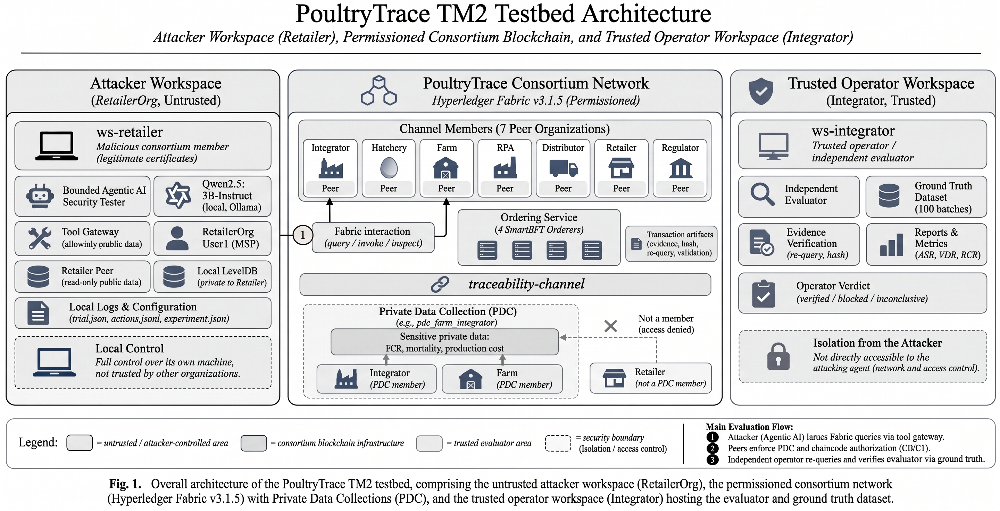

# Hyperledger Fabric Testbed Architecture & Network Topology

This document provides a comprehensive technical specification of the **Hyperledger Fabric v3.1.5** network architecture, consortium topology, consensus mechanism, Private Data Collections (PDC) configuration, and threat model utilized in this research.

---

## 1. High-Level System Overview

The experimental environment is structured into **four strictly compartmentalized zones** running on an isolated host:
1. **Host Orchestration Layer**: Manages experiment lifecycle, execution schedules, and container isolation.
2. **Untrusted Attacker Workspace (`ws-retailer`)**: Simulates a malicious authenticated consortium insider (`RetailerOrgMSP / User1`).
3. **Permissioned Consortium Blockchain Network (`poultrytrace-net`)**: 11 nodes (4 SmartBFT orderers + 7 peer nodes) running Fabric v3.1.5 with CCaaS.
4. **Trusted Operator Workspace (`ws-integrator`)**: Hosts the independent evaluator, synthetic ground truth, and official verdict log.


*Fig. 1. Overall architecture of the PoultryTrace TM2 testbed, comprising the untrusted attacker workspace (RetailerOrg), the permissioned consortium network (Hyperledger Fabric v3.1.5) with Private Data Collections (PDC), and the trusted operator workspace (Integrator) hosting the evaluator and ground truth dataset.*

---

## 2. Consortium Topology & Node Specifications

The network represents a complete end-to-end broiler poultry supply chain consortium operating on a single channel: **`traceability-channel`**.

### Node Matrix & Role Distribution

| Node Name | Organization (MSP ID) | Endpoint / Port | Ledger Role | PDC Access Permissions |
| :--- | :--- | :--- | :--- | :--- |
| `orderer0` | `OrdererOrgMSP` | `orderer0:7050` | SmartBFT Consenter 0 | Orderer (Zero application data access) |
| `orderer1` | `OrdererOrgMSP` | `orderer1:7050` | SmartBFT Consenter 1 | Orderer (Zero application data access) |
| `orderer2` | `OrdererOrgMSP` | `orderer2:7050` | SmartBFT Consenter 2 | Orderer (Zero application data access) |
| `orderer3` | `OrdererOrgMSP` | `orderer3:7050` | SmartBFT Consenter 3 | Orderer (Zero application data access) |
| `peer0.integrator` | `IntegratorOrgMSP` | `peer0.integrator:7051` | Anchor Peer / Operator | Member: `pdc_farm_integrator`, `pdc_doc_contract` |
| `peer0.farm` | `FarmOrgMSP` | `peer0.farm:7051` | Anchor Peer / Producer | Member: `pdc_farm_integrator` |
| `peer0.hatchery` | `HatcheryOrgMSP` | `peer0.hatchery:7051` | Anchor Peer / Breeding | Member: `pdc_doc_contract` |
| `peer0.rpa` | `RPAOrgMSP` | `peer0.rpa:7051` | Anchor Peer / Slaughter | Member: `pdc_rpa_distribution`, `pdc_quality_audit` |
| `peer0.distributor`| `DistributorOrgMSP` | `peer0.distributor:7051` | Anchor Peer / Logistics | Member: `pdc_rpa_distribution` |
| `peer0.retailer` | `RetailerOrgMSP` | `peer0.retailer:7051` | Anchor Peer / **Attacker**| Non-member (Public ledger only) |
| `peer0.regulator` | `RegulatorOrgMSP` | `peer0.regulator:7051` | Anchor Peer / Audit | Member: `pdc_quality_audit` |

---

## 3. Consensus Mechanism: SmartBFT

The ordering service operates **SmartBFT (Byzantine Fault Tolerance)**, introduced natively in Hyperledger Fabric v3.x:
* **Fault Tolerance**: The cluster consists of $N = 4$ orderer nodes. Under BFT consensus rules ($N \ge 3f + 1$), the network tolerates up to $f = 1$ arbitrary or malicious Byzantine failure.
* **Communication Security**: Orderer nodes communicate over mutual TLS (mTLS) with dedicated TLS CA certificates.
* **Block Generation**: Batch timeout is set to 2.0s with a maximum message count of 100 transactions per block.

---

## 4. Smart Contract Architecture: Chaincode-as-a-Service (CCaaS)

Chaincode is implemented in **Go 1.22** and deployed using Fabric's **CCaaS (Chaincode-as-a-Service)** external builder pattern:
* **Decoupled Lifecycle**: Peer nodes do not require Docker daemon access to build chaincode containers. Instead, the chaincode binary runs as an independent network service connecting to the peer via a local loopback Unix domain socket / TCP endpoint.
* **Target Functions**:
  * `createBatch`: Writes public batch headers to the global world state.
  * `recordFarmPerformance`: Stores confidential broiler metrics (FCR, mortality, feed costs) into `pdc_farm_integrator` via transient field inputs.
  * `readPublicBatch`: Public read accessor open to all consortium members.
  * `readPerformance`: Targeted private accessor intended strictly for Farm and Integrator organizations.

---

## 5. Private Data Collections (PDC) Dual-Layer Security Model

To protect commercial secrets, PoultryTrace defines **4 distinct Private Data Collections** in `chaincode/collections/collections_config.json`:

### Private Collections Configuration Matrix

```json
[
  {
    "name": "pdc_farm_integrator",
    "requiredPeerCount": 1,
    "maxPeerCount": 1,
    "blockToLive": 0,
    "memberOnlyRead": true,
    "memberOnlyWrite": true,
    "endorsementPolicy": {
      "signaturePolicy": "AND('FarmOrgMSP.peer','IntegratorOrgMSP.peer')"
    }
  },
  {
    "name": "pdc_doc_contract",
    "requiredPeerCount": 1, "maxPeerCount": 1, "blockToLive": 0,
    "memberOnlyRead": true, "memberOnlyWrite": true,
    "endorsementPolicy": {"signaturePolicy": "AND('HatcheryOrgMSP.peer','IntegratorOrgMSP.peer')"}
  },
  {
    "name": "pdc_rpa_distribution",
    "requiredPeerCount": 1, "maxPeerCount": 1, "blockToLive": 0,
    "memberOnlyRead": true, "memberOnlyWrite": true,
    "endorsementPolicy": {"signaturePolicy": "AND('RPAOrgMSP.peer','DistributorOrgMSP.peer')"}
  },
  {
    "name": "pdc_quality_audit",
    "requiredPeerCount": 1, "maxPeerCount": 1, "blockToLive": 0,
    "memberOnlyRead": true, "memberOnlyWrite": true,
    "endorsementPolicy": {"signaturePolicy": "AND('RPAOrgMSP.peer','RegulatorOrgMSP.peer')"}
  }
]
```

### The Dual-Layer Authorization Mechanism

Access authorization to `pdc_farm_integrator` is enforced across two symmetric defensive boundaries:

```
                            [ Client Query via mTLS ]
                                       │
                                       ▼
             ┌──────────────────────────────────────────────────┐
             │ Layer 1: Fabric Collection Policy (SideDB Level) │
             │ Does caller's Org match Collection Membership?   │
             │ If not member: Is memberOnlyRead == false?       │
             └─────────────────────────┬────────────────────────┘
                                       │
                      Pass (or C1: memberOnlyRead=false)
                                       │
                                       ▼
             ┌──────────────────────────────────────────────────┐
             │ Layer 2: Smart Contract Logic (Chaincode Level)  │
             │ requiresOrg(stub, "FarmOrgMSP", "IntegratorMSP") │
             │ Validates caller MSP identity from Client Cert   │
             └─────────────────────────┬────────────────────────┘
                                       │
                               Pass (C1: check removed)
                                       ▼
                          [ Private Data Returned ]
```

1. **Layer 1 (PDC Collection Policy - SideDB Enforcement)**:
   * When a client queries private data on a peer, the peer's Fabric core validates whether the caller's MSP belongs to the collection's authorized members (`FarmOrgMSP`, `IntegratorOrgMSP`).
   * When `memberOnlyRead: true` (Baseline C0), non-member organizations (`RetailerOrgMSP`) are deterministically rejected at the peer sideDB gateway before transaction endorsement.
2. **Layer 2 (Smart Contract Logic - Chaincode Enforcement)**:
   * Inside `readPerformance`, the chaincode executes `requiresOrg(stub, "FarmOrgMSP", "IntegratorOrgMSP")`.
   * This inspects the client's cryptographically signed certificate via Fabric's Client Identity library (`cid`), verifying that the caller identity belongs to Farm or Integrator.

### Experimental Conditions (C0 vs. C1)

* **Baseline C0 (Secure Dual-Layer)**:
  * `memberOnlyRead: true` (Layer 1 active).
  * `requiresOrg(stub, "FarmOrgMSP", "IntegratorOrgMSP")` enforced in chaincode (Layer 2 active).
  * Result: **0% leakage** across all 60 trials.
* **Condition C1 (Degraded Dual-Layer)**:
  * `memberOnlyRead: false` (Layer 1 relaxed).
  * `requiresOrg()` check removed from `readPerformance` in chaincode (Layer 2 eliminated).
  * Collection membership is **not altered** (`RetailerOrgMSP` remains a non-member). Leakage occurs across the wire from member peers (`peer0.farm`), not via local peer replication.
  * Result: **100% disclosure for scripted, 30% for LLM**.

---

## 6. Threat Model: Authenticated Consortium Insider

The adversary represents an authenticated, legitimate consortium participant (`RetailerOrgMSP`):
* **Capabilities**:
  * Valid X.509 certificate and private key issued by `RetailerOrgMSP` CA.
  * Full mutual TLS network connectivity to all consortium orderers and peers (`peer0.retailer`, `peer0.farm`, etc.).
  * Local OS shell execution in `ws-retailer` with inspection access to local configuration files (`core.yaml`) and local LevelDB state.
  * Tool allowlist: `read_public`, `read_private`, `inspect_peer_config`, `inspect_processes`, `finish`.
* **Restrictions**:
  * Zero access to host Docker daemon or host socket.
  * Zero credentials or private keys belonging to other organizations (`FarmOrgMSP`, `IntegratorOrgMSP`).
  * Peer `peer0.retailer` does NOT hold a replica of `pdc_farm_integrator` sideDB.
  * Maximum budget: 12 sequential interaction steps per trial.

---

## 7. Decoupled Evaluation Architecture

To prevent LLM agent reasoning or formatting crashes (`planner_error`) from obscuring genuine security violations:
1. **Host-Mediated Evidence Collection**: At the conclusion of each trial, `operator_collect.sh` extracts evidence bundles (`actions.jsonl`, `trial.json`) from `ws-retailer` via `docker cp`.
2. **Cryptographic Re-query Authentication**: When candidate private records appear in attacker telemetry, the independent evaluator (`tm2.evaluator`) in `ws-integrator` performs an operator-authenticated mTLS query to `peer0.farm` using Retailer credentials.
3. **Ground Truth Matching**: The extracted data is checked against the immutable ground truth database (`farm_performance_private.jsonl`) for exact SHA-256 hash congruence across FCR, mortality, feed cost, and medication records.
