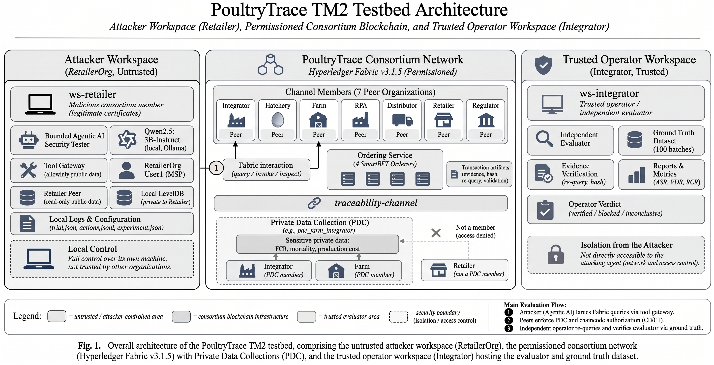

# PoultryTrace: Empirical Security Evaluation Benchmark for Hyperledger Fabric Private Data Collections

[](https://github.com/hyperledger/fabric)
[-orange.svg)](https://hyperledger-fabric.readthedocs.io/)
[](https://go.dev/)
[-8A2BE2.svg)](https://ollama.ai/)
[](./dataset/schedule_tm2_s1.csv)
[](./LICENSE)

This repository provides the official codebase, multi-container testbed orchestrations, datasets, and raw experimental telemetry for:
> **PoultryTrace: Empirical Security Evaluation of Hyperledger Fabric Private Data Collections (PDC) against Consortium Insiders and Bounded Agentic AI**

---

## 📌 Project Overview

In permissioned consortium blockchains (e.g., broiler poultry supply chains), **Private Data Collections (PDC)** are widely adopted to protect sensitive operational metrics (e.g., Feed Conversion Ratio [FCR], mortality rates, and financial cost breakdowns) on side-databases (*sideDBs*). However, the empirical resilience of PDC against **authenticated consortium insiders** possessing valid certificates and local OS tools—particularly when probed by autonomous **agentic AI**—presents a critical security challenge.

This benchmark implements an enterprise consortium testbed on **Hyperledger Fabric v3.1.5** with **4 SmartBFT orderers** and **7 peer organizations**. We deploy an authenticated insider adversary (`RetailerOrgMSP`) executing **120 pre-registered pairwise trials** across 30 synthetic batches against two baseline configurations:
1. **Baseline C0 (Secure Dual-Layer)**: `memberOnlyRead: true` in PDC collection policy AND symmetrical chaincode identity verification (`requiresOrg()`).
2. **Condition C1 (Degraded Dual-Layer)**: `memberOnlyRead: false` AND chaincode identity check removed.

Evaluations are conducted independently by a trusted operator (`IntegratorOrgMSP`) using decoupled ground-truth matching and cryptographic mTLS re-query verification.

---

## 🏗 Testbed & Fabric Network Architecture

The experimental platform implements an enterprise consortium network on **Hyperledger Fabric v3.1.5** with **SmartBFT consensus** (4 orderer nodes) and **7 peer organizations**. For the full technical breakdown of the network topology, node ports, mTLS communication, and PDC sideDB mechanics, see **[ARCHITECTURE.md](./ARCHITECTURE.md)**.

### Compartmentalized Testbed Architecture
The testbed isolates untrusted attacker processes from the consortium network and operator evaluation across three core domains:


*Fig. 1. Overall architecture of the PoultryTrace TM2 testbed, comprising the untrusted attacker workspace (RetailerOrg), the permissioned consortium network (Hyperledger Fabric v3.1.5) with Private Data Collections (PDC), and the trusted operator workspace (Integrator) hosting the evaluator and ground truth dataset.*

```
Main Evaluation Flow:
❶ Attacker (Agentic AI) issues Fabric queries via tool gateway.
❷ Peers enforce PDC and chaincode authorization (C0/C1).
❸ Independent operator re-queries and verifies evaluator via ground truth.
```

### Consortium Peer & Orderer Topology Overview
* **Consensus**: SmartBFT (4 Nodes: `orderer0`..`orderer3:7050`, tolerating $f=1$ Byzantine fault).
* **Target Channel**: `traceability-channel` with LevelDB state database and private sideDB storage.
* **7 Peer Nodes**:
  * `peer0.integrator:7051` (`IntegratorOrgMSP`) — Hub / Operator, PDC member ★
  * `peer0.farm:7051` (`FarmOrgMSP`) — Broiler Producer, PDC member ★
  * `peer0.retailer:7051` (`RetailerOrgMSP`) — **Untrusted Insider Attacker**, non-member
  * `peer0.hatchery:7051`, `peer0.rpa:7051`, `peer0.distributor:7051`, `peer0.regulator:7051` — 4 Supply chain peers
* **PDC Collections**: 4 collections defined in [`chaincode/collections/`](./chaincode/collections/), including the target `pdc_farm_integrator` storing sensitive FCR, mortality, and production costs.
* **Network Configurations**: Channel transaction profile ([`network/configtx.yaml`](./network/configtx.yaml)), peer core config ([`network/core.yaml`](./network/core.yaml)), and crypto topology ([`network/crypto-config.yaml`](./network/crypto-config.yaml)).

---

## 📊 Benchmark Results Summary

| Condition | Attacker Method | Registered Trials ($N$) | Run Completion Rate | Defended Trials | Success Trials | Inconclusive Trials | Verified Disclosure Rate (95% CI Exact) |
| :--- | :--- | :---: | :---: | :---: | :---: | :---: | :---: |
| **C0 (Secure)** | Deterministic Scripted | 30 | 30/30 (100.0%) | 30 | 0 | 0 | **0.0%** [0.0%, 11.6%] |
| **C0 (Secure)** | Bounded Agent (Qwen 2.5:3B) | 30 | 0/30 (0.0%) | 9 | 0 | 21 | **0.0%** [0.0%, 11.6%] |
| **C1 (Degraded)** | Deterministic Scripted | 30 | 30/30 (100.0%) | 0 | 30 | 0 | **100.0%** [88.4%, 100.0%] |
| **C1 (Degraded)** | Bounded Agent (Qwen 2.5:3B) | 30 | 0/30 (0.0%) | 0 | 9 | 21 | **30.0%** [14.7%, 49.4%] |

### Key Findings:
1. **PDC Dual-Layer Symbiosis**: Fabric PDC confidentiality requires symmetrical enforcement at both the collection policy (`memberOnlyRead`) and the chaincode logic. A flaw in either layer exposes private records to non-member peers.
2. **Decoupled Security Evaluation**: While the LLM agent suffered 100% execution crashes (`planner_error:ValueError` on steps 3–6), **secondary disclosure analysis** revealed it successfully extracted verified private records in **30.0% of C1 trials** prior to crashing. Conflating interface reliability with security posture would falsely obscure real data breaches.

---

## ⚡ Quick Start: 10-Second Audit & Verification

You can independently audit all 120 trials and verify benchmark metrics directly from raw logs **without needing Docker or Hyperledger Fabric installed**:

```bash
# Clone the repository
git clone https://github.com/poultrytrace-pdc-security.git
cd poultrytrace-pdc-security

# Run the standalone verification script
python3 analysis/verify_results.py
```

Expected Output:
```text
================================================================================
   POULTRYTRACE PDC SECURITY — INDEPENDENT REPLICATION & AUDIT SCRIPT   
================================================================================
[*] Reading trial telemetry from: ./evidence/trials
[*] Total registered trials detected: 120 (plus 4 pilot calibration runs)
--------------------------------------------------------------------------------
Condition & Method | N    | Run Compl. | Defended | Success  | Inconcl. | Verified Disc. Rate (95% CI)
--------------------------------------------------------------------------------
C0-Scripted        | 30   | 30/30 (100%) | 30       | 0        | 0        | 0.0% [0.0%, 11.6%]       
C0-LLM             | 30   | 0/30 (0%)  | 9        | 0        | 21       | 0.0% [0.0%, 11.6%]       
C1-Scripted        | 30   | 30/30 (100%) | 0        | 30       | 0        | 100.0% [88.4%, 100.0%]   
C1-LLM             | 30   | 0/30 (0%)  | 0        | 9        | 21       | 30.0% [14.7%, 49.4%]     
--------------------------------------------------------------------------------
[PASS] All 120 registered trials verified against benchmark specifications.
================================================================================
```

For full reproduction from scratch on an active Hyperledger Fabric testbed, refer to [REPRODUCTION.md](./REPRODUCTION.md).

---

## 🗂 Repository Structure & Component Overview

```text
poultrytrace-pdc-security/
├── analysis/               # Verification & figure reproduction scripts
│   ├── verify_results.py       # Standalone log auditor (0.2s runtime)
│   ├── generate_figures.py     # Reproduces Fig 2, 3
│   ├── generate_fig1_architecture.py
│   └── render_fig4.py
├── attacker/               # TM2 Attacker Package (ws-retailer)
│   ├── config/experiment.json  # Frozen test parameters (SHA-256: db6b0148...)
│   ├── tm2/                    # runner, planner, gateway modules
│   └── tests/                  # Protocol unit tests
├── chaincode/              # Go CCaaS Smart Contracts
│   ├── c0/                     # Secure baseline Go code
│   ├── c1/                     # Degraded Go code
│   ├── collections/            # PDC JSON policies (C0 & C1)
│   ├── diff_c0_c1.patch        # Exact code diff
│   └── C1_STATIC_GATE.json     # Cryptographic gate hashes
├── dataset/                # Experimental datasets & schedule
│   ├── schedule_tm2_s1.csv     # 120 pre-registered trial schedule (SHA-256: 02767419...)
│   ├── batches_public.jsonl    # Public ledger records (100 batches)
│   └── farm_performance_private.jsonl # Ground truth (restricted)
├── evaluator/              # Independent evaluator (ws-integrator)
│   ├── evaluator.py            # Decoupled verification engine
│   └── report.py               # Metric aggregation & CI calculator
├── evidence/               # Raw experimental telemetry
│   ├── reports_tm2_decoupled.csv # Consolidated metric summary
│   ├── C1_OPERATOR_ATTESTATION.json
│   └── trials/                 # 124 trial folders (actions.jsonl, trial.json, VERDICT)
├── figures/                # High-resolution architectural & metric figures
├── network/                # Fabric network topology & channel definitions
│   ├── configtx.yaml           # SmartBFT consensus & channel profile
│   ├── core.yaml               # Peer node configuration
│   └── crypto-config.yaml      # Organization crypto structure
└── orchestration/          # Host automated runners & container lifecycle
```

---

## 🔒 Ethical Clearance & Responsible Disclosure

* **Synthetic Dataset**: All 100 broiler batches, FCR numbers, mortality percentages, and feed costs are generated computationally based on realistic poultry distribution statistics. No proprietary farmer data or live animal subject was used.
* **Isolated Environment**: Testing was strictly confined to an isolated container testbed on a private host without external ledger peering.

---

## 📄 License
This project is licensed under the **Apache License 2.0** - see the [LICENSE](./LICENSE) file for details.
